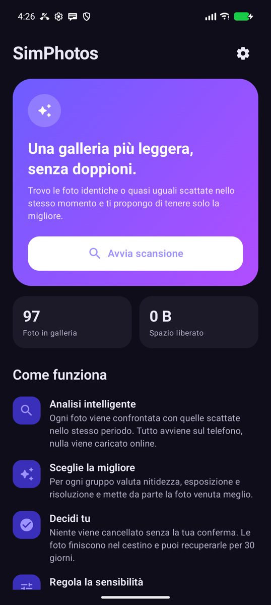
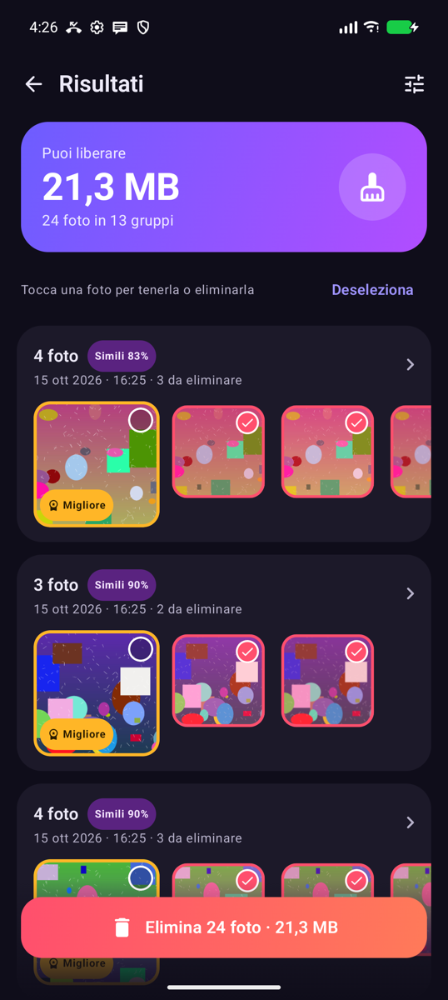
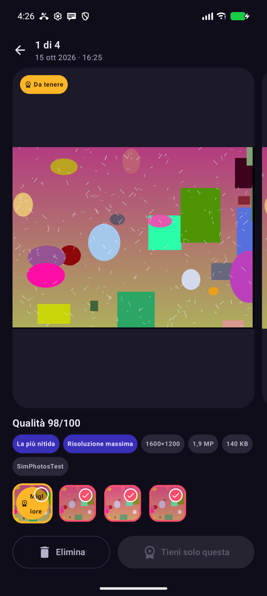

<div align="center">


# SimPhotos

**Una galleria più leggera, senza doppioni.**

SimPhotos trova le foto identiche o quasi uguali scattate nello stesso momento,<br/>
sceglie quella venuta meglio e ti aiuta a eliminare le altre in pochi tocchi.

[](https://github.com/carellice/SimPhotos/releases/latest/download/SimPhotos.apk)
&nbsp;


</div>

---

<p align="center">
  
  &nbsp;&nbsp;
  
  &nbsp;&nbsp;
  
</p>

## ✨ Cosa fa

- 🔍 **Analisi intelligente**: confronta ogni foto con quelle scattate nello stesso periodo e riconosce raffiche, scatti ripetuti e copie identiche.
- 🏆 **Sceglie la migliore**: per ogni gruppo valuta nitidezza, esposizione e risoluzione e mette da parte la foto venuta meglio.
- ✋ **Decidi tu**: niente viene cancellato senza la tua conferma. Prima vedi il riepilogo, poi confermi nel dialogo di sistema di Android.
- ♻️ **Cestino sicuro**: per impostazione predefinita le foto finiscono nel cestino e restano recuperabili per 30 giorni.
- ⭐ **Preferite protette**: le foto contrassegnate come preferite non vengono mai proposte per l'eliminazione.
- 🎚️ **Sensibilità regolabile**: scegli quanto devono essere simili le foto, da "Più permissivo" a "Solo quasi identiche".
- 🔒 **Privacy totale**: l'analisi avviene sul telefono. Nessuna foto lascia il dispositivo.
- 🔄 **Aggiornamenti integrati**: dalle impostazioni l'app controlla se c'è una nuova versione e la installa con un tocco.

## 📲 Installazione

1. Scarica **[SimPhotos.apk](https://github.com/carellice/SimPhotos/releases/latest/download/SimPhotos.apk)** dall'ultima release.
2. Aprilo sul telefono e consenti l'installazione da origini sconosciute, se richiesto.
3. Avvia SimPhotos, consenti l'accesso alle foto e premi **Avvia scansione**.

Gli aggiornamenti successivi si installano direttamente dall'app, in **Impostazioni → Aggiornamenti**.

## ⚙️ Impostazioni

| Opzione | Descrizione |
|---|---|
| Grado di somiglianza | Da 75% a 98%: più è alto, più le foto devono essere uguali per essere raggruppate |
| Periodo | Confronta le foto scattate entro 1 min, 10 min, 1 ora, 1 giorno o in tutto il rullino |
| Copie identiche ovunque | Trova i doppioni esatti anche se salvati in date diverse (es. da WhatsApp) |
| Includi screenshot | Analizza anche le catture dello schermo |
| Proteggi le preferite | Le preferite non vengono mai selezionate per l'eliminazione |
| Eliminazione | Cestino (recuperabile per 30 giorni) oppure definitiva |

## 🧠 Come funziona

Per ogni foto SimPhotos calcola, da una miniatura, un'impronta visiva composta da:

- **pHash** (trasformata DCT): resiste a piccole differenze di luce, compressione e dimensione;
- **dHash** (gradienti): descrive la struttura e la composizione dell'immagine;
- **firma colore** su una griglia 4×4.

Le foto scattate nello stesso intervallo che superano la soglia di somiglianza vengono raggruppate. In ogni gruppo la migliore si sceglie con un punteggio basato sulla **nitidezza** (varianza del Laplaciano), sull'**esposizione** e sulla **risoluzione**. Le impronte vengono salvate in locale, quindi le scansioni successive analizzano solo le foto nuove.

## 🛠️ Sviluppo

```bash
./gradlew :app:assembleDebug
```

Per pubblicare una nuova versione su GitHub basta fare doppio clic su `release.command`: incrementa la versione, compila l'APK, crea la release e rimuove quelle precedenti.

Struttura principale:

```
app/src/main/java/com/simphotos/app/
├── data/      # MediaStore, cache delle analisi, impostazioni
├── engine/    # hash percettivi, qualità, raggruppamento
├── update/    # controllo e installazione degli aggiornamenti
└── ui/        # schermate Compose e tema
```
